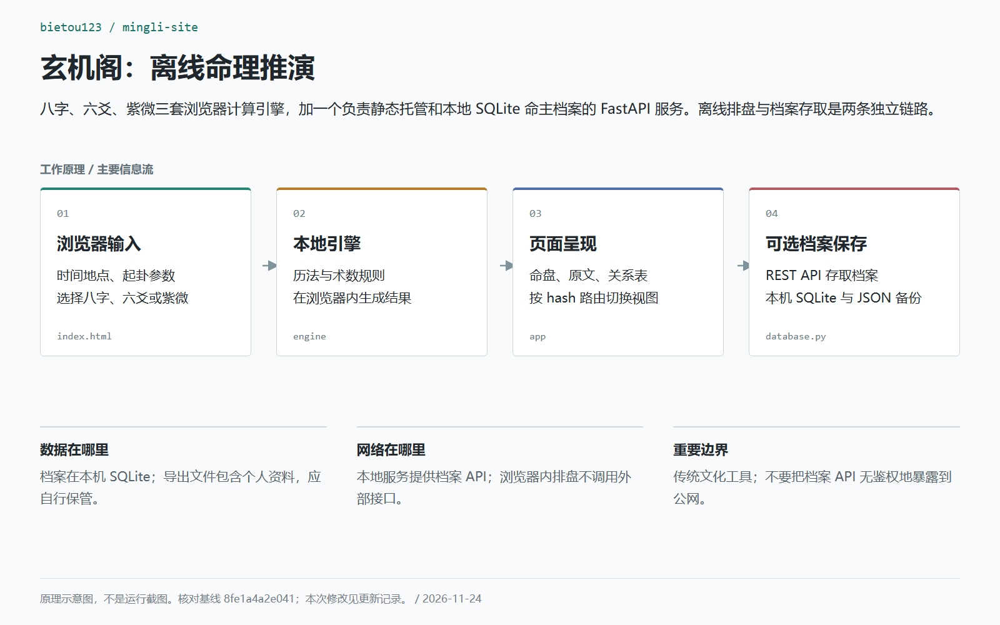

# 玄机阁：离线命理推演

八字、六爻、紫微三套浏览器计算引擎，加一个负责静态托管和本地 SQLite 命主档案的 FastAPI 服务。离线排盘与档案存取是两条独立链路。

**适合谁：** 需要本地排盘与档案管理，并希望查清计算和数据保存分别发生在哪里的使用者。

## 一图看懂



上图是依据公开源码绘制的原理示意，不是运行截图；以下表格与文字提供相同信息，便于小屏阅读。

## 主链路与源码

| 步骤 | 做了什么 | 代码或说明入口 |
| --- | --- | --- |
| 1. 浏览器输入 | 时间地点、起卦参数；选择八字、六爻或紫微 | [frontend/index.html](../frontend/index.html) |
| 2. 本地引擎 | 历法与术数规则；在浏览器内生成结果 | [frontend/js/engine](../frontend/js/engine) |
| 3. 页面呈现 | 命盘、原文、关系表；按 hash 路由切换视图 | [frontend/js/app](../frontend/js/app) |
| 4. 可选档案保存 | REST API 存取档案；本机 SQLite 与 JSON 备份 | [backend/database.py](../backend/database.py) |

## 关键原理

### 计算不用后端

前端 engine 目录实现历法和排盘，app 目录组织各页。通过本机 HTTP 静态服务加载前端即可离线计算；页面使用 ES Modules，不能在 Chromium 中直接双击 file:// 入口。FastAPI 的作用是档案 API 与静态托管，不是把出生数据发给远端模型。

对应入口：[frontend/js/engine/calendar.js](../frontend/js/engine/calendar.js)。

### 档案是一层本地服务

FastAPI 的档案 CRUD 与导入导出路由使用本机数据库。排盘页面与持久化通过数据契约连接，因此离线排盘可以工作，而依赖 API 的档案操作需要运行后端。

对应入口：[backend/main.py](../backend/main.py)。

### 缓存与备份各有职责

Service Worker 用于页面资源缓存，不等于备份档案数据库。要迁移资料，应使用档案 JSON 导出或妥善备份数据库；浏览器清缓存和删除数据库是不同操作。

对应入口：[frontend/sw.js](../frontend/sw.js)。

## 数据与安全边界

| 范围 | 说明 |
| --- | --- |
| 数据 | 档案在本机 SQLite；导出文件包含个人资料，应自行保管。 |
| 网络 | 本地服务提供档案 API；浏览器内排盘不调用外部接口。 |
| 重要边界 | 传统文化工具；不要把档案 API 无鉴权地暴露到公网。 |

## 运行与复现

Windows 运行 start.bat；Linux 运行 bash start.sh。默认地址为 http://127.0.0.1:8090。仅排盘可运行 python -m http.server 8000 --bind 127.0.0.1 --directory frontend，再打开 http://127.0.0.1:8000；不应直接双击 frontend/index.html。

在满足主 README 的依赖与前置条件后，可使用这些现有验证入口：

```text
node tools/smoke-test.mjs
```

命令是复现入口，不代表本次重跑了所有历史测试；本轮实测范围见更新说明。

## 已知限制

- 仅静态 HTTP 服务不提供后端档案 API；PWA 安装与缓存取决于浏览器和来源。
- 命理解释不构成医疗、法律、投资或现实事件的保证。

## 本次更新

2026-11-24：新增项目专属原理图、源码入口、运行条件与边界说明。本项目本轮没有修改功能，也没有扩大既有实测结论。

## 可编辑流程图

下面的 Mermaid 与上方 PNG 表达同一主链路，便于后续维护：


[返回项目 README](../README.md)

源码核对基线：[8fe1a4a2e041](https://github.com/bietou123/mingli-site/tree/8fe1a4a2e041046f2eabb06d62919008d90faa1a)，并结合本次更新中列明的改动。
